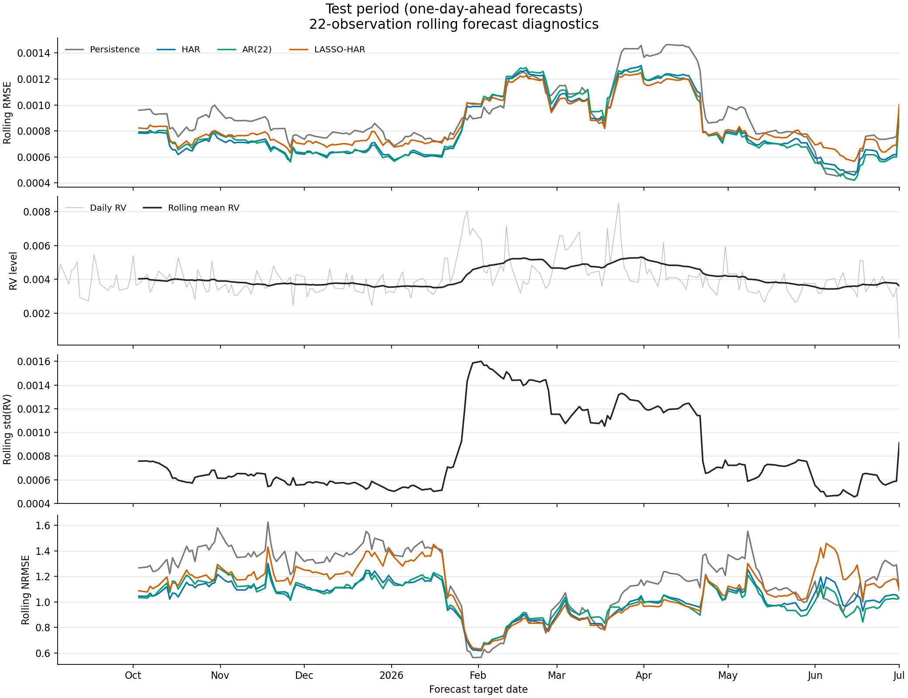

# HAR-RV forecasting for USD/CHF

This project compares a few ways of forecasting daily USD/CHF volatility: the HAR-RV model, an unrestricted AR(22), LASSO, and a simple persistence forecast that uses today's volatility as tomorrow's prediction.

The analysis starts with bid/ask tick data, builds a daily realized-volatility series, and compares the models on the same test period.

## Data and volatility estimates

The raw ticks cover January 2022 to June 2026. After removing duplicate ticks and weekend observations, I calculate log prices as the average of the log bid and log ask, then group returns into trading days using a fixed 22:00 UTC boundary.

Daily realized variance is calculated at the tick level and across ten staggered subgrids. A two-scale correction combines these estimates, and taking the square root gives the daily realized volatility used by the models.

The saved dataset contains 1,170 daily observations. Its trading-day labels run from 3 January 2022 to 1 July 2026; the final observation covers only part of a trading day because the raw data end on 30 June.

The large raw CSV files stay in `download/` locally. The smaller derived datasets are included in `data/`.

## Analysis

[`notebooks/setup.ipynb`](notebooks/setup.ipynb) builds the volatility series and estimates the HAR-RV model using today's volatility and its five-day and 22-day averages to predict the next trading day.

It also works through the OLS calculations, reports Newey-West standard errors with five lags, and compares HAR with AR(22) using a nested-model F-test, AIC, and BIC. The fitted HAR values and their in-sample errors are saved alongside the daily volatility series.

[`notebooks/lasso_har_model_selection.ipynb`](notebooks/lasso_har_model_selection.ipynb) fits LASSO with 100 candidate daily volatility lags. It uses the first 80% of the usable observations for training and the final 20% for testing: 856 training observations and 214 test observations. The penalty is selected through five-fold time-series cross-validation, with scaling fitted separately inside each fold.

HAR and AR(22) are fitted again on the same training rows for the test comparison. Their coefficients, along with LASSO's, stay fixed during the test period, while the predictors update as each day's observed volatility becomes available.

The notebook also compares training and test errors, errors relative to each sample's volatility variation, and rolling forecast diagnostics over 22 observations.

## Results from the saved run

All four models are evaluated on the same 214 test observations.

| Model | Test RMSE | Test MAE |
| --- | ---: | ---: |
| Persistence | 0.0009622 | 0.0007229 |
| HAR | 0.0008639 | 0.0006564 |
| AR(22) | 0.0008680 | 0.0006525 |
| LASSO-HAR | 0.0008914 | 0.0006920 |

HAR has the lowest test RMSE, while AR(22) has the lowest test MAE. All three estimated models improve on persistence under both measures. LASSO retains seven of the 100 candidate predictors: lags 1, 2, 3, 4, 5, 14, and 20, where lag 1 is today's volatility.

Absolute errors are lower in the test period for every model. The test period also has less variation in realized volatility, and RMSE divided by the target's standard deviation is higher in testing for every model. The notebooks include both measures to put the error comparison in context.



## Files

- `notebooks/`: volatility construction, estimation, model comparison, and diagnostics.
- `data/usdchf_daily_realized_volatility.csv`: daily variance estimates and realized volatility.
- `data/usdchf_har_dataset.csv`: HAR predictors and the next-day target.
- `data/usdchf_har_in_sample_forecasts.csv`: fitted HAR values and forecast errors from the full-sample regression.
- `figures/`: rolling forecast diagnostics in PNG and PDF format.

## Running the notebooks

The notebooks use Python with NumPy, pandas, SciPy, statsmodels, scikit-learn, and Matplotlib. To install these packages and Jupyter:

```sh
python -m pip install jupyter numpy pandas scipy statsmodels scikit-learn matplotlib
```

The notebooks currently contain local Windows paths. Update `download_dir` in `setup.ipynb`, and the input CSV and figure directory paths in `lasso_har_model_selection.ipynb`, to match your project folder.

Run `setup.ipynb` to rebuild the daily data from raw tick CSVs with `timestamp` (Unix milliseconds), `askPrice`, and `bidPrice` columns. To work from the included daily data, open `lasso_har_model_selection.ipynb` directly. The saved outputs show the results described above.

## Reference

Corsi, F. (2009). *A Simple Approximate Long-Memory Model of Realized Volatility*. Journal of Financial Econometrics.
